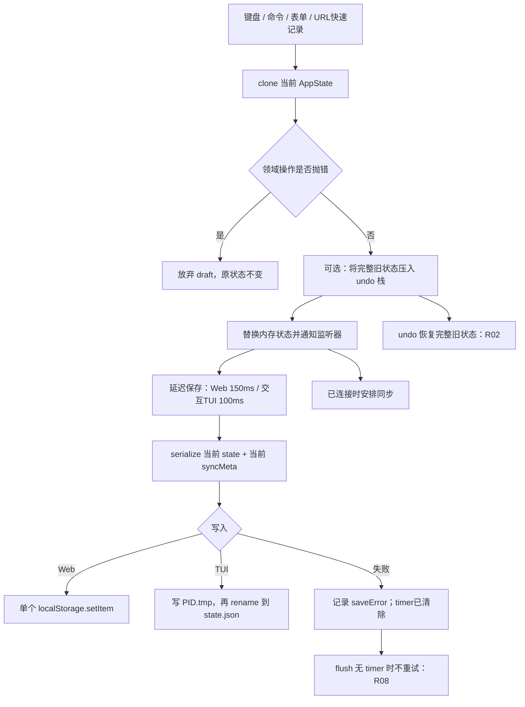
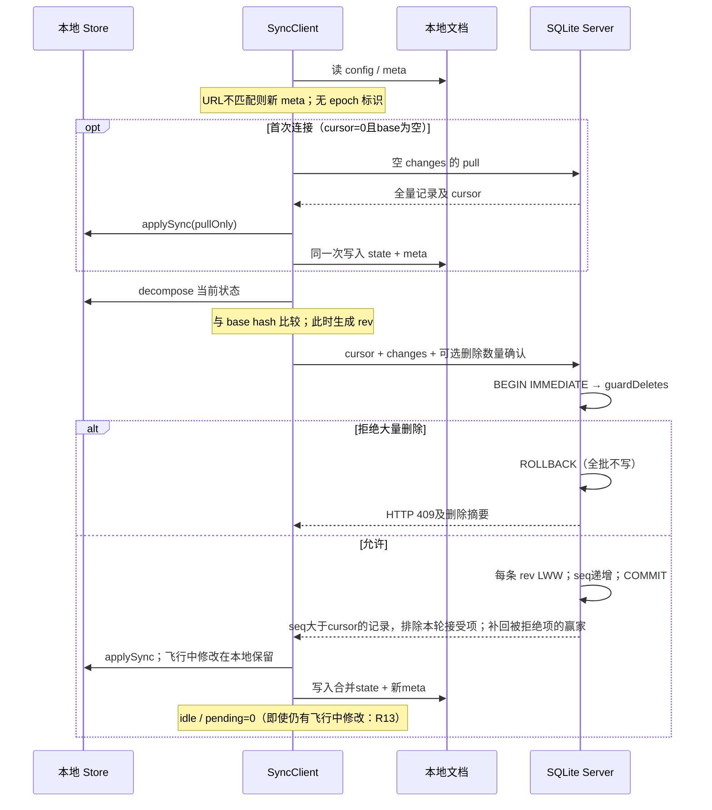

# 状态转换与数据生命周期模型

基于 `d689f7209ede359ecd5639eee934fb18c4e64bd8` 的实际代码，而非仅依据设计文档。

## 领域状态

| 实体 | 状态 / 转换 | 本地约束 | 跨端约束现状 |
|---|---|---|---|
| Plan / Goal | active / paused / done / archived 任意切换；delete 从数组移除 | 删除同时移除嵌套内容和关联 Compact，保留 Session | LWW 元信息；删除记录留 tombstone；无关系事务校验 |
| Task / Move | pending / active / done / blocked / skipped；cycle 为 pending→active→done→pending，其余→pending | 激活时把同工作区其他 active 改 pending；done 设置 doneAt，其他状态清除 | 按 task 独立合并，不保证最多一个 active（R05） |
| Phase | pending→active→done；activate 可重开 done，清除 doneAt | activate 清除其他 active；complete 尝试激活后续阶段；delete 连带删除该阶段任务 | 逐记录合并，不校验任务/阶段的组合不变量 |
| Session segment | 未结束→endedAt / tokens 固化；切换模型或强度关闭旧 segment 并创建共享 runId 的新 segment | start 拒绝已有未结束 Session；activeSession 返回第一个未结束项 | 多设备可独立创建多个 active；计费会累加重叠区间（R05） |
| PlanVersion | 首次执行基准 v1；commit / revise 增量编号；无独立恢复命令 | 编号等于本地最后版本号+1；snapshot 包括阶段和非 skipped 任务 | 键为 `ver:<planId>:<v>`，并发编号碰撞（R04）；首次 revise 基准顺序错误（R10） |
| Checkpoint | 追加 id，更新 Goal.nextAction | progress 截断为 0–100；至少填写一项 | 独立 checkpoint 合并，Goal.nextAction 整记录 LWW |
| Log | emit 追加 id，工作区内 at 单调递增 | 最多 2000；旧项直接裁剪 | 实际支持更新和 tombstone，并非严格 append-only |
| Compact / Fatigue | 追加；Compact 每工作区最多 20；markFatigue 上限 1000 | 裁剪通过数组过滤 / splice | 缺失于 base 的已知项会产生 tombstone，裁剪传播到其他端 |
| UI | mode、选中的工作区、lastSeenAt、dismissedCompactId | 本地文档保存；compose 修复无效工作区选择 | 不拆分成同步记录；同设备多窗口仍共享同一文档 |

## Store 与持久化

Store 的 mutate 返回成功只表示内存提交，不是持久化确认。读取异常、写入异常和同步异常是三个独立状态，TUI 未展示 saveError。
Web 只在 beforeunload 调用 flush；可见性变为 hidden 没有保存钩子。TUI CLI 主动 flush 两次，但没有检查返回后的 saveError。
撤销栈只在内存中，普通 mutation 最多 50 项，replace 没有同样的上限；远程 apply 不新增 undo 项，也不重定基已有 undo 快照。

同一文档保存 state 和 meta 是正确的提交粒度，但不提供多写入者互斥。TUI watch 为变更后 120ms 的整状态 reload，不能把已发生的丢失更新找回；Web 无 storage/BroadcastChannel/Web Locks 协調（R03）。

## 同步状态机与提交点

客户端内存 `running` 只串行化**同一 SyncClient 实例**，不协调窗口或进程。debounce 默认 1.5 秒，后台每 30 秒 pull；没有持久化 outbox 和稳定请求 ID。中断重试重新 prepare / 生成 rev，因此不是幂等重放（R01）。

`applySync` 先在 flat map 合并，再 compose。没有 parent 的子项被丢弃；阶段不存在的任务重挂到第一阶段；task/phase 的 `_o` 相同时仅靠稳定 sort 的输入顺序排序，不同端输入顺序不同（R12）。它不会统一 active 状态、冲突快照或版本号。

批量删除规则：一次请求删除至少 2 个 workspace、删除最后一个 workspace，或删除内容至少 20 条且超过现有内容一半。日志不计内容比率。guard 在 SQLite 事务内、写入前执行，具有原子拒绝性质；授权只有 `confirmDeletes: number`，没有删除 ID 集合或摘要（R11）。阈值以下删除、更新覆盖以及记录 ID 碰撞都不在保护范围内。

`confirm` 仅为客户端状态字段，并不冻结后续请求集合；后台继续尝试同步，服务器仍逐次检查 guard。`restoreFromServer` 清空 base/cursor 再首次 pull；它不是恢复历史版本或撤回其他设备已发生的删除。

## 恢复及保留矩阵

| 边界 | 恢复来源 / 语义 | 已验证或限制 |
|---|---|---|
| mutation 尚未延迟保存就进程退出 | 上一份本地文档 | 未保存修改丢失；故障控制测试明确展示此边界 |
| TUI rename 前 / 后 SIGKILL | 旧 / 新的完整文档 | 4 个真实进程崩溃测试中的 2 个验证 state/meta 成对恢复 |
| SQLite COMMIT 前 / 后 SIGKILL | WAL 恢复，旧 / 新完整事务 | 另外 2 个测试验证 task 和 log 同进退，integrity_check=ok |
| 网络请求未到服务端 | 原本地 state/base，重试 | 正向控制通过 |
| 服务端已提交但响应丢失 | 服务器有新记录，本地仍旧 base | 重试时重发新 rev，可能覆盖后来修改（R01） |
| saveMeta 的原子 IO 写入失败 | 磁盘旧的完整 state/meta | 控制测试通过；内存 meta 已推进，不能把内存 loadMeta 当作持久化确认 |
| connect 首次同步失败 | prevState / prevMeta / prevConfig | 整状态回滚会吞掉期间本地编辑（R06）；不能保证撤销服务端已提交数据 |
| 同 URL 服务端回滚 / 换库 | 无 epoch；只用数字 cursor | 不探测数据库历史回退，出现静默分叉（R07） |
| export / import | AppState JSON，无设备 syncMeta、服务端 seq/rev/tombstones | import 覆盖本地且可同步为新更新/删除；不是服务端一致性备份恢复协议 |
| 解析失败的本地文件 | TUI `.corrupt.<time>` / Web `.corrupt.<time>` | Web 备份失败异常被忽略；可能仍提示“已备份”，列为潜在风险 |
| 日志/Compact/疲劳被裁剪 | 无持久历史归档 | tombstone 没有旧 payload；export 只包含当前 live 状态 |
| PWA 离线打开 | Service Worker shell/资产缓存 | 不存业务数据；HTTP 503 能污染 shell（R14） |
| 系统断电 | 文件系统 / SQLite 持久性参数 | 未验证；TUI 无 fsync，SQLite synchronous=NORMAL，不能外推 SIGKILL 测试结论 |
